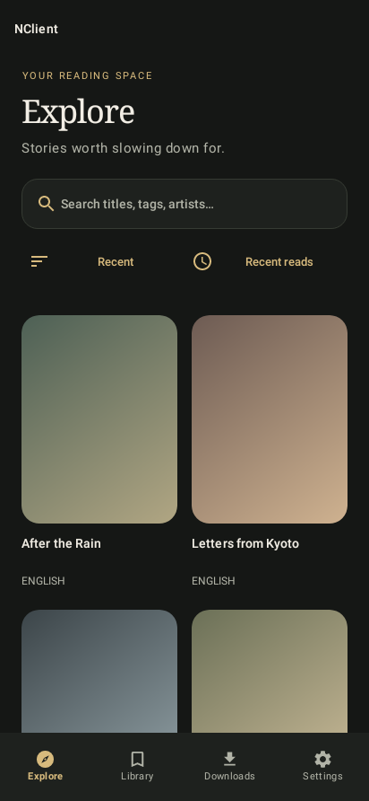
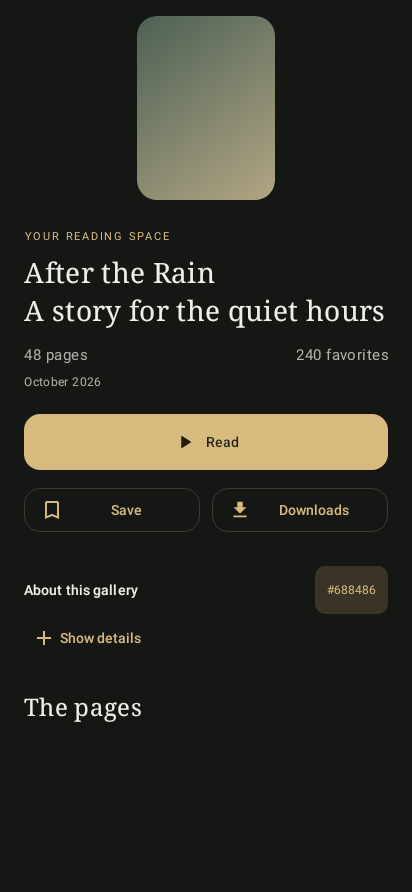
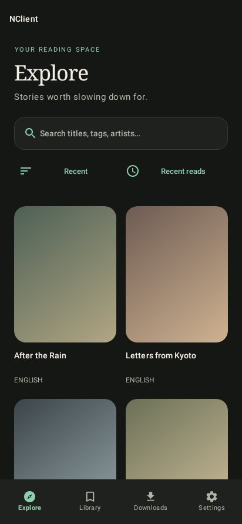
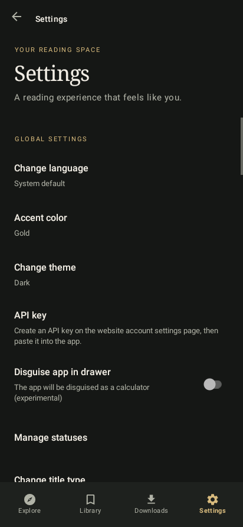
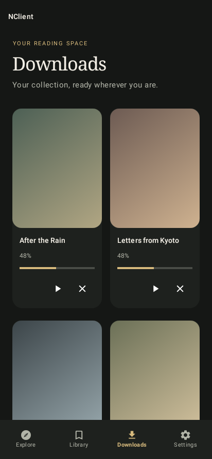
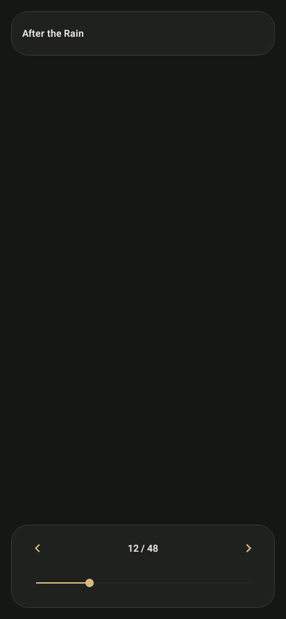
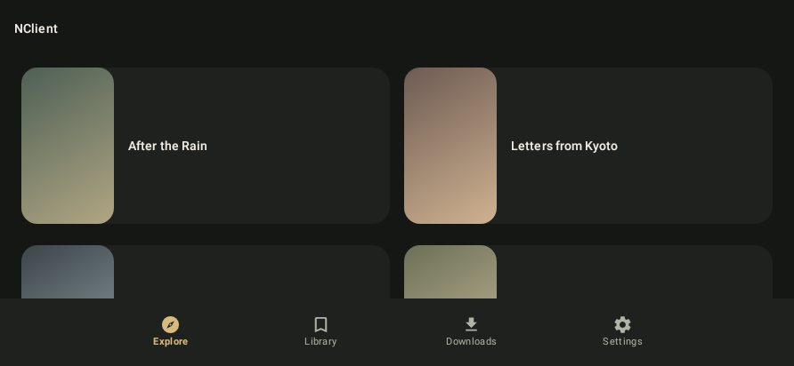

# Premium UI — build 420706

The app now uses warm dark surfaces, ivory text, serif headings and generous
spacing. Rounded covers have their own title area instead of text over images.
Light and true-black themes remain available.

## Choose your accent

Open **Settings → Accent color** and choose **Gold, Jade, Ocean, Amethyst, Rose,
or Copper**. Gold is the default. The saved choice updates buttons, navigation,
chips, dialogs and progress controls, including screens reopened from the back
stack. Each accent has a light and dark palette.

## New layouts and flow

- **Explore, Library, Downloads and Settings** are available in bottom navigation.
  Explore includes search, sorting and recent reads; the drawer retains the other
  destinations. Switching tabs avoids building an ever-growing activity stack.
- Browsing uses large covers, separate captions and subtle reading-status strips.
  Narrow phones and short landscape screens use horizontal cards so titles remain
  visible. Column preferences are bounded by the space actually available.
- Gallery details have a cover/title header, prominent **Read / Resume** and
  **Save / Downloads** actions, expandable tags and a separate page grid.
- Reader controls float in rounded panels with larger touch targets and gentle
  fades. Existing page retry, browser diagnostics and working CDN discovery remain.
- Downloads separate cover art, progress and actions. Settings use spacious rows,
  wrapped summaries and the new accent selector. Search, comments, history,
  bookmarks and API-key entry share the new visual language.

The working API/CDN and archive-download behavior from build 420705 is retained.
Public reading requires no key; authenticated archives still require an API key
and server support. No credentials are included in these APKs.

## Rendered previews

These are native Android renderings of the production XML using Robolectric.
Titles and gradient covers are fictional test fixtures, not app content. The
previews omit device system bars and are not screenshots from a physical phone.

| Explore · Gold | Gallery |
| --- | --- |
|  |  |

| Explore · Jade | Settings |
| --- | --- |
|  |  |

| Downloads | Reader controls |
| --- | --- |
|  |  |

Additional previews: [narrow phone](ui/small-screen.png) · [light theme](ui/light-theme.png).

## Validation

Both APK variants build successfully. Each runs 63 tests (126 total), including
13 UI checks covering native layout rendering, Android 12 inflation, narrow and
landscape screens, large text in API-key entry, accent contrast and persistence
through the actual Settings preference. Android lint reports zero errors; warnings
remain. Physical-device animation, gesture and accessibility behavior still need
on-device review.

The debug application ID and signing identity match build 420705. Install the
[new APK](../apks/README.md) over **NClientV3 Debug** to retain its data.
